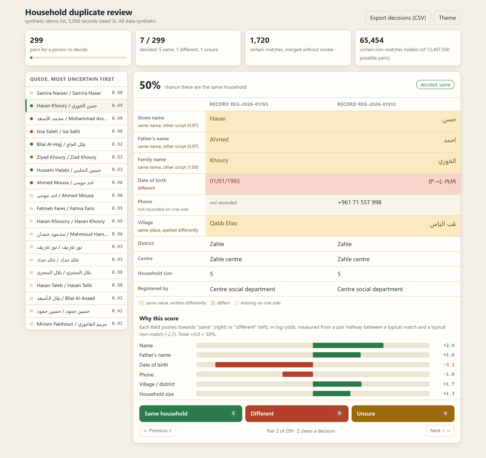
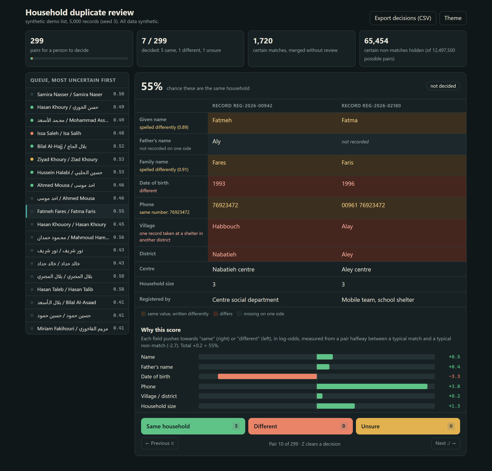
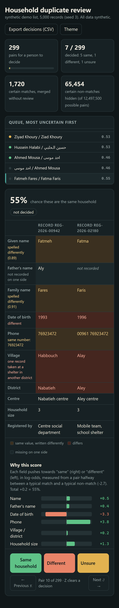

# beneficiary-dedupe

Finds the same family registered twice under different spellings, across Arabic and Latin script, and lets a reviewer confirm each match.

All data in this repository is synthetic. A seeded script invents the households, names, phone numbers and registrations, set in the work of a humanitarian organization in Lebanon during an emergency response. Nothing here touches real people.



<p>


</p>

## The need

When people are displaced, we register families wherever we find them. The social department registers them at our centre in their district. A mobile team registers them again at a school shelter two districts away. A volunteer writes a paper list at a distribution point, and someone types it up a week later. The same father is "Mohammad Khoury" on one list, "Mohamed El Khouri" on another and "محمد الخوري" on the third, with a different village because the family has moved. When we miss that, one family gets two food parcels and another family gets none. Nobody can compare ten thousand rows by eye before the next distribution.

## Try it

```bash
python -m venv .venv
source .venv/bin/activate          # Windows: .venv\Scripts\activate
pip install -e .
dedupe serve                       # review screen on http://127.0.0.1:8108
```

`dedupe serve` builds a 5,000-record synthetic list, scores it and opens the queue (a few seconds). Keys: `S` same, `D` different, `U` unsure, `J`/`K` next and previous, `Z` clears a decision. Decisions are saved to `decisions.json` after every click, so a power cut loses nothing. "Export decisions" downloads them as CSV.

On your own CSV (columns `record_id, given_name, father_name, family_name, date_of_birth, phone, village, district, centre, household_size, team`):

```text
$ dedupe generate --n 10000 --out records.csv
Wrote 10000 synthetic records to records.csv

$ dedupe run records.csv --out matches.csv
Read 10,000 records
Compared 266,578 candidate pairs out of 49,995,000 possible
  certain matches:     3,591
  for a reviewer:      805
  certain non-matches: 262,182 (not written)
Households with more than one record: 2,043
Wrote matches.csv and matches_households.csv in 8.5 s
```

`dedupe serve records.csv` opens that list in the review screen; `dedupe bench` reproduces the numbers below. If your system blocks the `dedupe` launcher, `python -m beneficiary_dedupe <command>` does the same. More output: [docs/sample-output.txt](docs/sample-output.txt).

## How it works

```
records ─► normalise ─► block ─► compare ─► score ─► cluster ─► review queue
           (3 keys)    (4 passes) (20 features) (logistic   (guarded)   (uncertain
                                                regression)              pairs only)
```

| Step | What it does |
|---|---|
| Normalise | Arabic: alef and hamza forms (أ إ آ → ا), taa marbuta (ة → ه), alef maqsura (ى → ي), diacritics, tatweel, the article ال. Latin: accents, `El`/`Al` prefixes, punctuation. Dates in four formats and Arabic-Indic digits. Lebanese phones in any format become one national number (`+961 3 123 456`, `03123456` and `٠٣١٢٣٤٥٦` all give `3123456`). |
| Shared key | A consonant skeleton that both scripts map onto: `Mohamed El Khouri` and `محمد الخوري` both give `mhmd` + `Xr`. Vowels are dropped, the article is removed, and letters that transliterations confuse (`k/q`, `ch/sh`, `g/j`) map to one class. |
| Phonetic key | A coarser code on top of the skeleton, used for blocking. On 191 pairs of Latin spellings of the same name, Soundex agrees on 72.8% and this key on 99.5%. Soundex keeps the first letter as written (`Chehab` C110, `Shehab` S110) and reads `El Khoury` as starting with E. |
| Blocking | Four passes: both names in either order; one name plus birth year; phone; family name plus village. 10,000 records give about 255,000 pairs to compare instead of 49,995,000. The benchmark prints how many true pairs blocking drops. |
| Features | Given and family name similarity, aligned the better of two ways, so a swapped name order still lines up. Across scripts, a weighted alignment where a Latin short vowel costs almost nothing but an Arabic long vowel must be matched. This separates Hassan from Hussein (حسن / حسين) and Mohammad from Mahmoud. Date of birth: exact, day and month swapped, year only, same year, one year apart. Phone, village, district, household size. **Shelter registration:** when one record was taken by a team at a shelter (the `team` or `centre` column says "shelter") and the districts differ, a different village is expected and does not count against the match. |
| Score | Logistic regression fitted on a training set made with its own seed. Each pair's log-odds split exactly into one number per field, measured from a reference pair halfway between a typical match and a typical non-match. The bars on the screen are the model itself, not a story told about it. |
| Bands | Thresholds chosen on training pairs: at or below 0.047 is a certain non-match, at or above 0.707 a certain match. Both are counted and kept out of the reviewer's way. Policy rule: a pair whose given names clearly differ is never accepted without a person. |
| Cluster | Strongest pairs first. Two groups merge only if every pair across them scores at least 0.02, and pairs that blocking never compared are scored on demand. Groups stay at 6 records or fewer, and a held pair is never the link that merges two groups. |

## Results

**How the held-out set was kept honest.** After the generator was re-set in this scenario, the held-out set (10,000 records, seed 2) and its labels were written to [data/heldout.csv](data/heldout.csv) and committed before any rule changed. The shelter feature was then designed and checked only on the training seed (1) and a separate development seed (4). The model was retrained on seed 1, and the held-out file was measured once at the end. A test fails if the generator ever drifts from the frozen file. Full output: [docs/benchmark.txt](docs/benchmark.txt).

```text
True duplicate pairs: 3854  (Arabic-to-Latin: 1509, home centre to shelter: 671)

method                                       precision  recall     F1  AR-LA rec  shelter rec
Exact name + date of birth                       1.000   0.028  0.054      0.000        0.013
Levenshtein on full name >= 0.84                 0.297   0.275  0.285      0.000        0.255
This pipeline, pairs scored >= 0.5               0.986   0.973  0.979      0.964        0.964
This pipeline, after clustering                  0.993   0.972  0.983      0.954        0.966
```

The Levenshtein threshold (0.84) was tuned on the training set for its best F1, over all 50 million pairs with no blocking.

**Displaced households.** Of 671 true pairs between a home-centre record and a shelter record, 621 are certain matches, 47 go to the reviewer and 3 fall in the certain non-match band. 96.6% end up in one household automatically. On the development seed, the shelter feature raised this from 92.8% to 95.6%.

**New numbers next to the old ones.** The old column is the first version of this project ([docs/benchmark-before-rebase.txt](docs/benchmark-before-rebase.txt)). It used a generator with no centres and no shelter registrations. The two held-out sets are different data, so this is not a like-for-like comparison.

| Held-out measure | Before | Now |
|---|---|---|
| Precision / recall / F1 after clustering | 0.992 / 0.971 / 0.981 | 0.993 / 0.972 / 0.983 |
| Arabic-to-Latin recall | 0.954 | 0.954 |
| Home centre to shelter recall | not measured | 0.966 |
| Blocking recall (candidate pairs) | 0.9982 (276,688) | 1.0000 (254,975) |
| Pairs in the review queue | 866 | 743 |
| Pairs to review for 95% / 98% recall | 58 / 239 | 9 / 198 |
| After a correct review of the queue: precision / recall | 0.999 / 0.992 | 0.997 / 0.995 |
| Twins wrongly merged | 2 of 126 | 10 of 135 |
| Siblings / namesakes wrongly merged | 4 of 621 / 0 of 534 | 3 of 653 / 6 of 472 |
| Time for 10,000 records | 14.1 s | 3.7 s |

**Speed.** Run on a Windows laptop with Python 3.12 in one process. Times vary with whatever else the machine is doing: the same 10,000-record step took between 3.7 and 14.1 s across runs.

## Where it fails

Real errors from the held-out run:

- **Twins, and a short name inside a long one.** Twin brothers `Waleed | Walid | Younis` and `Ali | Waleed | Younis` were born the same day and share a phone and a village. They were put in one household (p = 1.000). The twin rule should have held the pair, but "Ali" scores 0.87 against "Waleed": Jaro-Winkler finds a, l, i in order inside "walid", so the names do not count as clearly different. Twins went from 2 of 126 to 10 of 135 pairs merged, the largest regression. I found this on the held-out set and left the rule unchanged, since fixing it there would be tuning on the test.
- **An estimated age that lands on a namesake.** `Abas | Aly | Hamdan | 06/11/1975 | Dures` is a different man from `Abbas | Ali | Hamdan | 12/11/1972 | Douris`. The second man was registered again without papers, and the registrar guessed `1975`. That record matches the first man on every field (p = 0.722), and his household was merged into the other.
- **Displacement plus two other changes.** `هدي | خالد | جابر | 26/6/1967 | Saida shelter` against `Houda | Khaled | Jaber | 26/6/1966 | Qana`: the village, the birth year and the phone all changed, and the given name was written with ya instead of alef maqsura. It scored 0.002 and was hidden as a certain non-match. Three shelter pairs are lost this way.
- **Typos in the given name across scripts.** `محود | رامي | درويش` (a typo of محمود) against `Mahmood | Rami | Darwish` scores 0.998. But the given names fall under the "clearly different" line, so the pair goes to the queue instead of being merged. This is the price of the twin rule.
- **French spellings with silent letters.** `Georges` keeps its final s in the consonant key, so it does not share a key with جورج (`George` does).
- **Same consonants, different long vowels.** The shared key cannot tell محمد from محمود, or Hassan from Hussein. The vowel-aware score narrows the gap but does not close it.
- **The data is synthetic.** The model learned this generator's error rates, and the shelter feature relies on the team or centre column saying "shelter". On a real list, the weights and both thresholds should be refitted on a few hundred reviewed pairs before the certain-match band is trusted.

## What I would add next

- Refit the weights from the reviewer's own decisions (`decisions.json` already holds the labels), and sort the queue to ask about the pairs that would teach the model most.
- Compare household member lists (spouse and children names), which separate twins and namesakes better than any head-of-household field.
- A language model could write the one-line reason for each queued pair in Arabic or English. The per-field numbers are already there, but it has not been built or tested here.

## Layout

`src/beneficiary_dedupe/`: `generate.py` and `names.py` (synthetic data), `normalize.py` and `similarity.py` (keys and name similarity), `blocking.py`, `features.py`, `model.py` (with `model.json`, the trained weights), `cluster.py`, `pipeline.py`, `app.py` and `static/index.html` (review screen), `bench.py`, `cli.py`. Frozen held-out set in `data/`. Tests in `tests/` (`pytest`).

## Licence

MIT, see [LICENSE](LICENSE).
