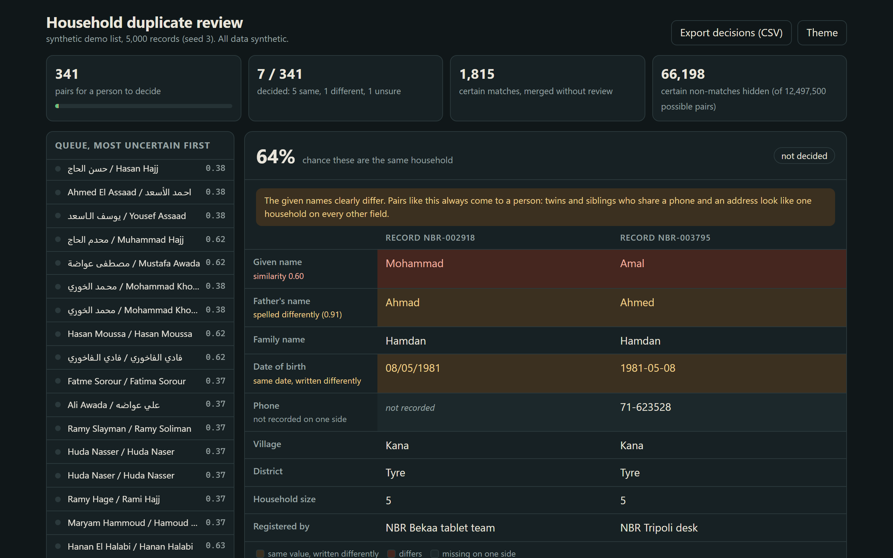

# beneficiary-dedupe

Finds the same family registered twice under different spellings, across Arabic and Latin script, and lets a reviewer confirm each match.

All data in this repository is synthetic. The households, names, phone numbers and registration teams are generated by a seeded script for a fictional response by Northbridge Relief, a fictional NGO, in Lebanon. Nothing here touches real people.


<p>


</p>

## The need

In an emergency response, households are registered by different teams, on paper and on tablets, in Arabic and in several Latin transliterations. The same family appears as "Mohammad Khoury", "Mohamed El Khouri" and "محمد الخوري". Duplicates mean one family is assisted twice and another not at all. Exact matching misses them, and a person cannot compare ten thousand rows by hand.

## Try it

```bash
python -m venv .venv
source .venv/bin/activate          # Windows: .venv\Scripts\activate
pip install -e .
dedupe serve                       # review screen on http://127.0.0.1:8108
```

`dedupe serve` builds a 5,000-record synthetic list, scores it and opens the queue (about 10 seconds). Keys: `S` same, `D` different, `U` unsure, `J`/`K` next and previous, `Z` clears a decision. Decisions are saved to `decisions.json` after every click, so a power cut loses nothing, and "Export decisions" downloads them as CSV.

On your own CSV (columns `record_id, given_name, father_name, family_name, date_of_birth, phone, village, district, household_size, team`):

```text
$ dedupe generate --n 10000 --out records.csv
Wrote 10000 synthetic records to records.csv

$ dedupe run records.csv --out matches.csv
Read 10,000 records
Compared 272,369 candidate pairs out of 49,995,000 possible
  certain matches:     3,623
  for a reviewer:      935
  certain non-matches: 267,811 (not written)
Households with more than one record: 2,071
Wrote matches.csv and matches_households.csv in 11.0 s
```

`dedupe serve records.csv` opens that list in the review screen; `dedupe bench` reproduces the numbers below. If your system blocks the `dedupe` launcher, `python -m beneficiary_dedupe <command>` does the same.

## How it works

```
records ─► normalise ─► block ─► compare ─► score ─► cluster ─► review queue
           (3 keys)    (4 passes) (19 features) (logistic   (guarded)   (uncertain
                                                regression)              pairs only)
```

| Step | What it does |
|---|---|
| Normalise | Arabic: alef and hamza forms (أ إ آ → ا), taa marbuta (ة → ه), alef maqsura (ى → ي), diacritics, tatweel, the article ال. Latin: accents, `El`/`Al` prefixes, punctuation. Dates in four formats and Arabic-Indic digits. Lebanese phones in any format to one national number (`+961 3 123 456`, `03123456`, `٠٣١٢٣٤٥٦` all give `3123456`). |
| Shared key | A consonant skeleton both scripts map onto: `Mohamed El Khouri` and `محمد الخوري` both give `mhmd` + `Xr`. Vowels are dropped, the article is removed, and letters that transliterations confuse (`k/q`, `ch/sh`, `g/j`) map to one class. |
| Phonetic key | A coarser code on top of the skeleton for blocking. On 191 pairs of Latin spellings of the same name, Soundex agrees on 72.8% and this key on 99.5%, because Soundex keeps the first letter as written (`Chehab` C110, `Shehab` S110) and reads `El Khoury` as starting with E. |
| Blocking | Four passes (both names in either order; one name plus birth year; phone; family name plus village). 10,000 records give 276,688 pairs to compare instead of 49,995,000, and blocking keeps 99.82% of the true pairs. The benchmark prints how many it drops. |
| Features | Given and family name similarity, aligned the better of two ways (so a swapped name order still lines up). Across scripts, a weighted alignment where a Latin short vowel costs almost nothing but an Arabic long vowel must be matched, which separates Hassan from Hussein (حسن / حسين) and Mohammad from Mahmoud. Date of birth: exact, day and month swapped, year only, same year, one year apart. Phone, village, district, household size. |
| Score | Logistic regression fitted on a training set made with its own seed. Each pair's log-odds split exactly into one number per field, measured from a reference pair halfway between a typical match and a typical non-match. The bars on the screen are the model itself, not a story told about it. |
| Bands | Thresholds chosen on training pairs: below 0.033 is a certain non-match, above 0.737 a certain match. Both are counted and kept out of the reviewer's way. Policy rule: a pair whose given names clearly differ is never accepted without a person. |
| Cluster | Strongest pairs first. Two groups merge only if every pair across them scores at least 0.02 (pairs blocking never compared are scored on demand), groups stay at 6 records or fewer, and a held pair is never the link that merges two groups. |

## Results

From `dedupe bench` on a held-out set of 10,000 synthetic records (seed 2). The model was trained on seed 1, so these are different households. Full output: [docs/benchmark.txt](docs/benchmark.txt).

```text
True duplicate pairs: 3858  (Arabic-to-Latin: 1513)

method                                       precision  recall     F1  AR-LA recall
Exact name + date of birth                       1.000   0.029  0.056         0.000
Levenshtein on full name >= 0.84                 0.295   0.272  0.283         0.000
This pipeline, pairs scored >= 0.5               0.989   0.968  0.979         0.957
This pipeline, after clustering                  0.992   0.971  0.981         0.954
```

The Levenshtein threshold (0.84) was tuned on the training set for its best F1, over all 50 million pairs with no blocking.

**Reviewer workload.** 3,626 pairs are certain matches (precision 0.999) and 272,196 are certain non-matches, so 866 pairs out of 276,688 go to a person. If the reviewer decides that queue correctly, pair recall reaches 0.992 at precision 0.999. 24 true pairs sit in the certain non-match band.

```text
Reviewer workload: pairs a person must look at to reach a pair recall
  recall     model queue   Levenshtein order   unranked candidates
  0.90                 0         not reached               249,019
  0.95                58         not reached               262,854
  0.98               239         not reached               271,154
```

**Hard negatives** (different households generated to look alike), pairs wrongly put in one household:

```text
  neg:namesake                    0 of  534   same name, same village, other father
  neg:namesake_same_father        1 of  159   cousins with the same three names
  neg:sibling                     4 of  621
  neg:twin                        2 of  126
```

**Chaining guard.** Plain connected components reach a largest cluster of 7 records at precision 0.978. With the guard and the given-name hold, the largest cluster has 4 records and precision is 0.992, for 1.2 points of recall.

**Speed.** Processing all 10,000 records (prepare, block, compare, score, cluster) took 14.1 s in the run quoted above: Windows laptop, Python 3.12, one process. Other jobs shared the machine: over the last three benchmark runs the same step took 8.5, 10.6 and 14.1 s.

## Where it fails

Real errors from the held-out run:

- **Brothers who share a phone.** `Hussein | Omar | Masri | 22/3/1964 | 78102469 | Khiam` was merged with `Hassan | Omar | Al-Masri | 1968-08-02 | 78102469 | El Khiam` (p = 0.858). These are two brothers with the same father, phone and village. In Latin script, Hussein and Hassan score above the "clearly different" line, so the hold does not apply.
- **Common name, year only.** `Mohammad | - | Hamdan | 14/3/1971` and `Mohammad | Abdullah | Hamdan | 1971` are two different men in the same village (spelled Bebnine and Bibnin), merged at p = 0.752. With the father's name missing on one side and only a year on the other, there is little left to tell them apart.
- **Typos in the given name across scripts.** `اممد | رامي | طالب` (a typo of احمد) against `Ahmed | Ramy | Talib` scores 0.997, but the given names fall under the "clearly different" line. The pair goes to the review queue instead of being merged automatically. This is the price of the twin rule: automatic recall drops from 0.979 to 0.971.
- **French spellings with silent letters.** `Georges` keeps its final s in the consonant key, so it does not share a key with جورج (`George` does).
- **Same consonants, different long vowels.** The shared key cannot tell محمد from محمود or Hassan from Hussein. The vowel-aware score narrows the gap (Mahmoud against محمد scores 0.91, Mohammad 0.96) but does not close it.
- **Blocking drops 7 of 3,858 true pairs** (0.18%). These are records where the name, birth year, phone and village all changed at once.
- **The data is synthetic.** The model learned this generator's error rates. On a real list, the weights and the two thresholds should be refitted on a few hundred reviewed pairs before the certain-match band is trusted.

## What I would add next

- Refit the weights from the reviewer's own decisions (`decisions.json` already holds the labels), and sort the queue to ask about the pairs that would teach the model most.
- Compare household member lists (spouse and children names), which separate twins and namesakes better than any head-of-household field.
- A language model could write the one-line reason for each queued pair in Arabic or English. The per-field numbers are already there, but it has not been built or tested here.

## Layout

`src/beneficiary_dedupe/`: `generate.py` (synthetic data), `normalize.py` and `similarity.py` (keys and name similarity), `blocking.py`, `features.py`, `model.py` (with `model.json`, the trained weights), `cluster.py`, `pipeline.py`, `app.py` and `static/index.html` (review screen), `bench.py`, `cli.py`. Tests in `tests/` (`pytest`).

## Licence

MIT, see [LICENSE](LICENSE).
